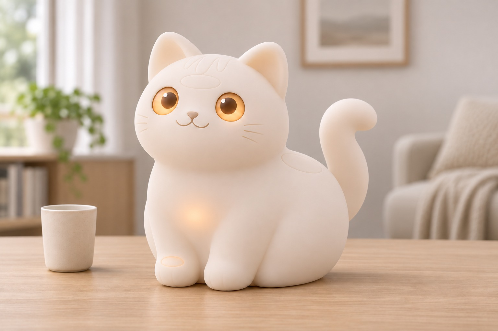
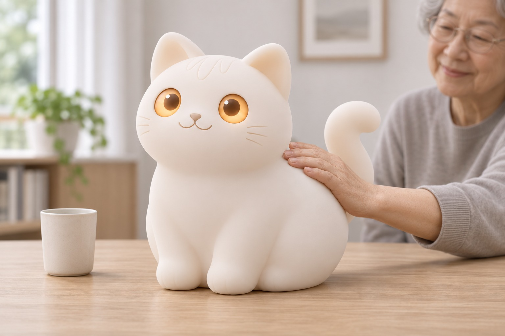
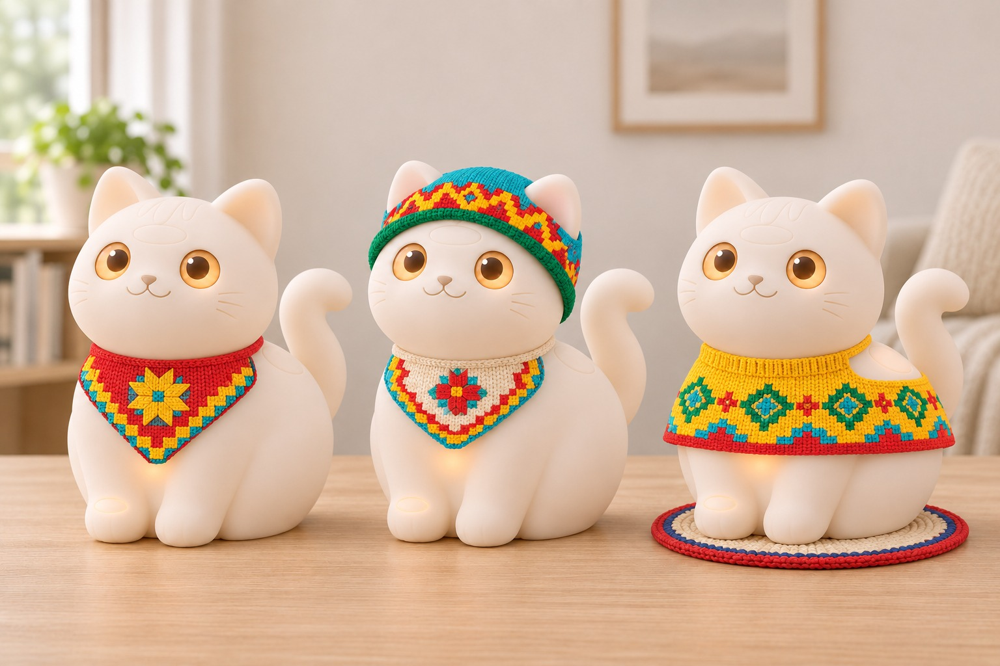
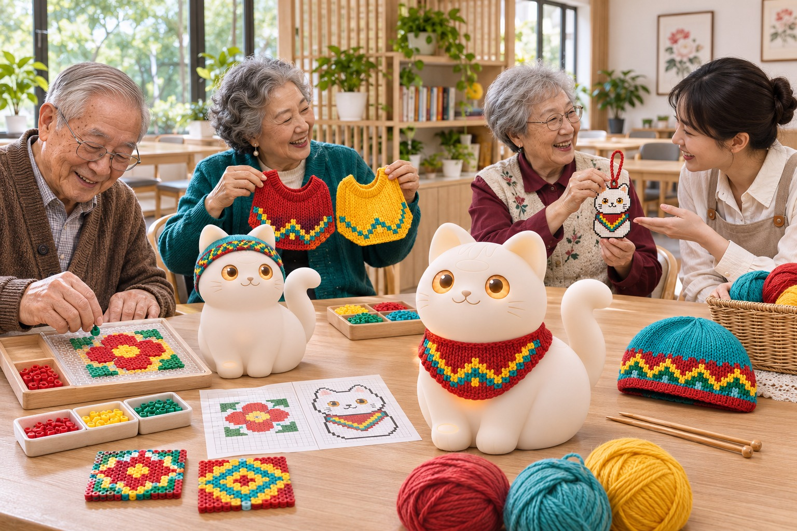
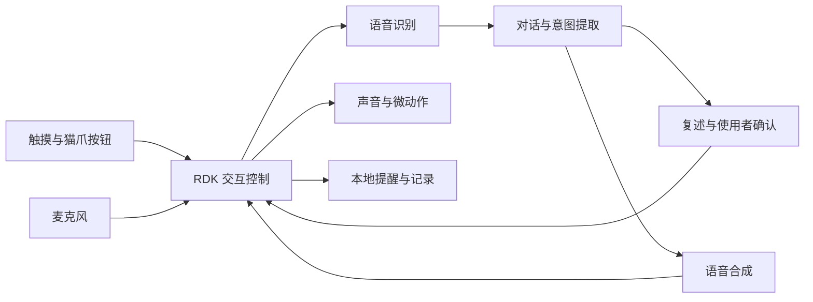

# 小满 · Xiaoman

## 有伴的日子，刚刚好。

**一只会说家乡话的柔软桌面陪伴猫。**

喜欢你摸摸它，也愿意听你说说话。

*概念渲染：乳白柔软硅胶、琥珀眼睛、局部暖光与身体触点；约28–30厘米的桌面尺度通过打样验证。*

你摸摸它，它便轻轻呼噜；你说起往事，它陪你聊聊家常。我们希望使用者愿意给它留一个位置，偶尔摸摸它、和它说说话，在每天的小互动中，多一份小小的牵挂。

小满面向老年人的日常陪伴，前期构想围绕养老机构的使用场景展开。计划以地瓜 RDK 为核心，结合柔软触感、语音交流和简单动作，制作可以亲手互动的桌面原型。

> **当前阶段：前期设计深化与原型准备。** 已有 26 页养老陪伴产品方案及猫形、使用情景的视觉探索，现已整理为“小满”的产品定位、交互流程、技术调研和开发计划；下一阶段开展 RDK 搭建与实测。

**快速查看：**[微光与长者手作](docs/COCREATION.md) · [产品手册 PDF](assets/xiaoman-handbook.pdf) · [开发计划](docs/DEVELOPMENT.md)

## 柔软，从摸得到的地方开始

*抚摸概念：手掌自然贴着背侧，表达柔软而有支撑的触觉目标。实际变形与回弹通过材料小样测定。*

## 给小满织件小衣，也给日常添份牵挂

小满的乳白猫形保持统一，围兜、露耳帽和短披肩用朱红、明黄、湖蓝与翠绿表达不同偏好。原创菱格、阶梯和小花以针目组成像素感，还可延伸为拼豆包挂、杯垫和小相框。

计划与养老机构、社区手工坊开展共创，由长者参与选色、织作、拼豆和试穿，让自己的手艺成为小满日常的一部分。参与方式、作品用途和报酬在开展前共同商定。详见[微光与长者手作](docs/COCREATION.md)。

## 相处，从三个小场景开始

| 时刻 | 计划中的体验 | 设计关注 |
| --- | --- | --- |
| 经过时，摸摸它 | 轻摸头部，小满呼噜，并轻轻动一动 | 愿意亲近的触感、及时而轻柔的回应 |
| 坐下来，聊聊家常 | 用普通话或家乡话聊饮食、兴趣与生活 | 自然的成年人表达、简短回应、耐心等待 |
| 生活里的小惦记 | 说出喝水或活动提醒，确认后设置，到时按猫爪确认 | 容易理解的操作和清楚的反馈 |

“小满”表达对平常生活的珍惜。一声呼噜，几句闲话，希望人与它逐渐形成熟悉的相处方式。

*未来手工坊场景概念：讨论选色、手作、试穿与分享的相处方式，活动结果随实际开展补充。*

## 首版准备做什么

面向上海地瓜机器人黑客松，拟完成以下交互原型：

- **触摸回应：**摸头触发本地呼噜或一个微动作。
- **局部微光：**猫爪输入与一处暖光先联调，亮度和夜间行为可设置。
- **简短对话：**按猫爪进入说话，先跑通普通话，再开展上海话场景试点。
- **生活提醒：**提出事项与时间 → 复述确认 → 到时提醒 → 按猫爪确认。
- **可见记录：**本地页面展示提醒内容、时间和确认状态。
- **柔软形态：**圆头、短腿和卷尾的坐姿猫形，连续柔软的硅胶表皮；先做局部触感、传感与装配小样。

**演示情景：**摸摸头，听到呼噜；告诉小满“一分钟后提醒我喝水”；确认后，到时听到提醒，再按猫爪完成确认。

## 实现思路

RDK 负责触摸、按钮、音频、动作状态、计时与本地记录；语音识别、对话和语音合成先通过服务接入。提醒的确认、建立、触发与完成由确定的程序逻辑执行。

方言选型参考阿里云公开文档及 Qwen3-ASR、CosyVoice 等公开项目。上海话的识别、声音气质和实际拾音表现，将通过真实样本比较后确定。详细组件与来源见[技术调研](docs/RESEARCH.md)。

## 如何判断原型做好了

计划验证触摸反馈是否容易理解、体验者是否愿意再次互动，以及声音的清晰度和亲切感。工程验收目标为核心流程连续完成三次、确认操作对应正确任务，以及断网后本地触摸与已有提醒继续响应。

上述功能与指标均为开发及验证目标，完成后将在仓库补充实物、视频和测试记录。

## 资料导航

| 资料 | 内容 |
| --- | --- |
| [微光与长者手作](docs/COCREATION.md) | 触点、鲜彩针织、像素衍生品、共创计划与案例 |
| [前期探索与设计进展](docs/DESIGN.md) | 已有方案积累、本轮造型和养老机构情景 |
| [公开版产品手册 PDF](assets/xiaoman-handbook.pdf) | 产品故事、设计图、交互与参赛计划 |
| [产品与交互](docs/PRODUCT.md) | 使用场景、关系感、形态与语音性格 |
| [开发与验证计划](docs/DEVELOPMENT.md) | 三天安排、物料、技术分工与验收 |
| [公开技术调研](docs/RESEARCH.md) | 方言能力、开源组件、产品参考及原始链接 |
| [一分钟项目介绍](docs/PITCH.md) | 参赛口头介绍与计划演示流程 |

## 组队方向

发起者具有建筑规划与室内设计背景，具备 SketchUp 建模基础，拟负责产品定义、形态建模、触摸与语音交互设计、体验测试和路演展示。

计划组成 2—3 人团队，寻找熟悉 **RDK / 嵌入式、音频接口、语音服务或简单机构**的伙伴。欢迎通过本仓库 [Issues](https://github.com/Niki-Spatial-Art/xiaoman-companion-cat/issues) 交流。
