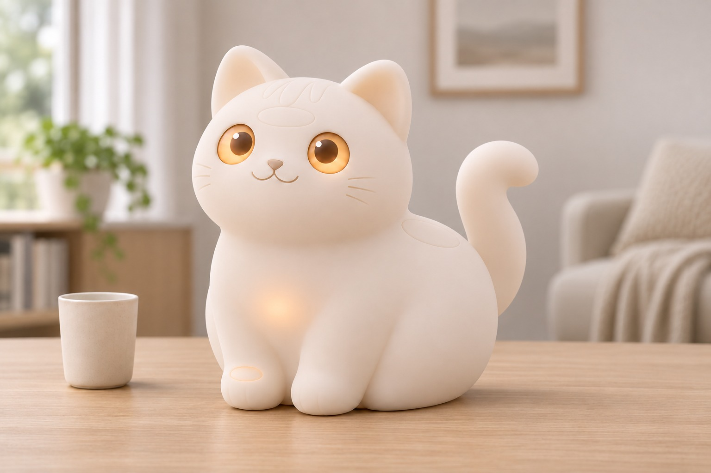
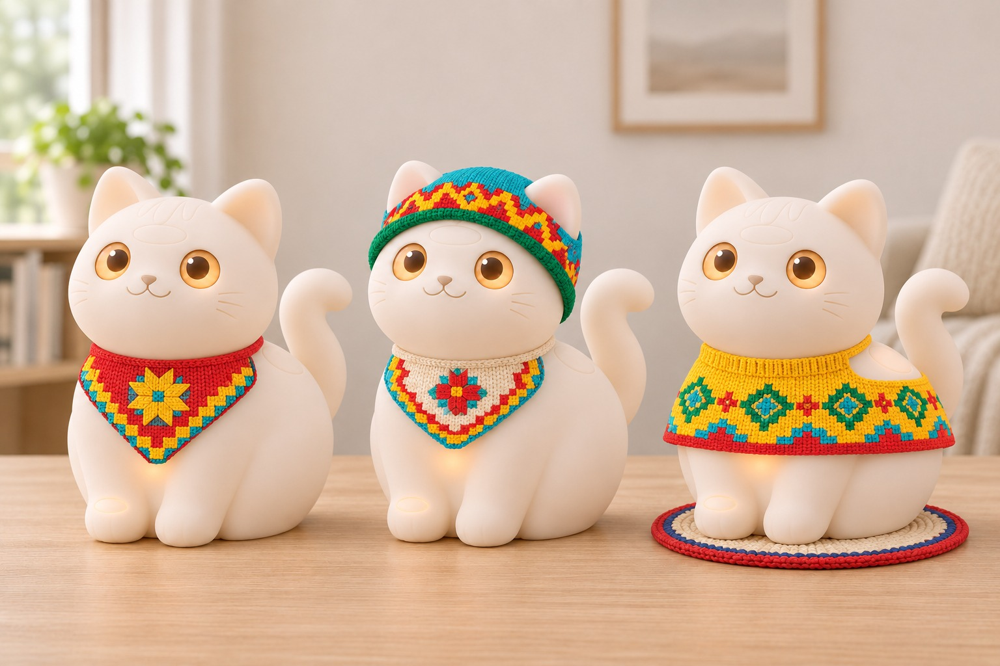
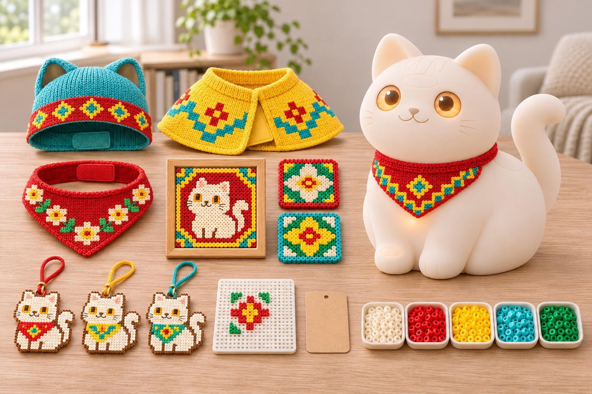
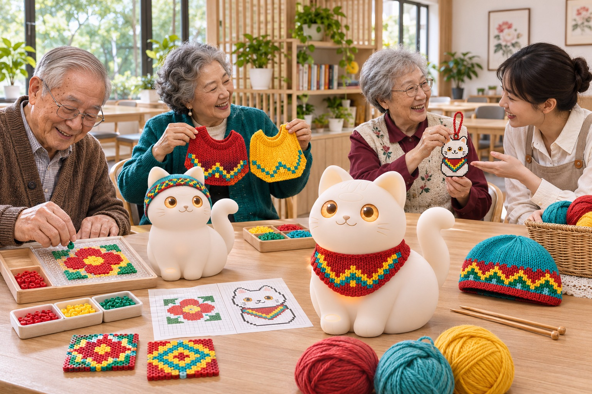

# 微光、触点与长者手作

**给小满织件小衣，也给日常添一份牵挂。**

本轮将小满的柔软硅胶猫形继续发展为可触摸、可回应、可装扮的桌面陪伴对象。以下为产品设计与拟开展的共创计划。

## 微光与触点

*概念渲染：乳白硅胶主体、胸腹局部暖光与猫爪触点。概念尺度约28–30厘米，尺寸、透光与传感结构通过打样确定。*

| 区域 | 拟定操作 | 反馈与设计目标 |
| --- | --- | --- |
| 额头 | 轻摸 | 呼噜回应；触点以同材质浅浮雕提示位置 |
| 上背 | 自然抚摸 | 声音或一个微动作回应，接触区保持平顺柔软 |
| 猫爪 | 按下说话或确认 | 触点边缘微光提示已响应，功能由当前状态确定 |
| 胸腹 | 状态显示 | 局部暖白或琥珀微光缓入缓出，表达收到触摸、正在听或提醒状态 |

光从局部硅胶透出，眼睛保留自然反射，身体以乳白色软皮为主。使用者可调整亮度与夜间行为，也可关闭灯光。原型先做猫爪输入与一处灯光，再联调额头、上背触摸。

灯光与声音共同表达操作结果，语音明确说出提醒事项和确认状态。通过体验测试比较触点是否容易找到、灯光是否清楚而舒适，以及声音和亮度是否适合公共空间与床头。

## 小满的小衣柜

| 款式 | 设计方向 | 与机身的配合 |
| --- | --- | --- |
| 日常小围兜 | 朱红针织口水巾，明黄、湖蓝菱格包边和像素小花 | 短前片露出胸腹灯光，侧面开合 |
| 露耳小帽 | 湖蓝与翠绿翻边帽，红黄阶梯纹帽檐，为两只猫耳预留开口 | 帽体偏后，额头触点保持可触及 |
| 四季小披肩 | 明黄色短披肩，原创几何纹带与浅前领 | 给上背触摸区、胸腹灯光与猫爪留空 |
| 桌边小坐垫 | 鲜彩几何边框薄织垫 | 结合底部结构验证平稳、清洁与通风 |

配件优先采用可拆洗、低掉絮的棉质或棉混纺线材，侧面大开合便于穿脱。裁片与针织版型围绕传感、拾音、出音与散热位置设计，先验证围兜和露耳帽两款。

### 鲜彩与方格纹样

小满保持乳白硅胶猫形、琥珀眼睛与局部微光。鲜亮颜色集中在可更换的配件上，以朱红、明黄、湖蓝、翠绿和米白组成多套配色，由参与者按个人喜好挑选。

本轮以菱格、阶梯、小花和连续边框构成带有民艺织锦感的原创几何纹样，用针目和绣格呈现像素化效果。具体地域纹样可在与当地手工艺者共创时选定，并记录来源与参与者贡献。

### 像素衍生品

同一套方格图可发展为针织花边、刺绣贴片、拼豆小满包挂、几何花杯垫和像素小相框。小满的像素形象保留奶白色猫身、短耳、琥珀眼睛和卷尾，让配件图案与产品形象建立联系。

首轮以大格图样和简单杯垫入手，依据参与者视力、手部操作与兴趣调整格数和材料尺寸；拼豆熨烫安排专人完成。织物与成品拼豆分别试制，按实际材料调整图样比例和固定方式。

## 拟探索的养老机构与社区手工坊

*未来使用场景的概念渲染。机构合作、作品制作与参与者反馈在实际活动后记录。*

计划与养老机构、社区手工坊开展小规模共创，由愿意参与的长者挑选颜色、编织、拼豆、试穿并分享经验。设计者提供适配小满的基础版型、方格图、样衣和材料包；熟悉手作的长者可成为共同设计者或带领者。

小满因此多了一层相处方式：使用者可以摸摸它、和它聊聊，也可以为它织一件小衣，或把自己的作品送给另一位使用者。手作配件承载个人偏好和制作者的故事，让同样的猫形逐渐成为“我家的小满”。

拟定流程：选色与选款 → 按基础版型织作 → 在小满上试穿 → 调整开口与固定方式 → 清洁及互动检查 → 自愿署名与作品分享。活动节奏随参与者的兴趣与体力安排，作品用途、工时与报酬事先协商。

首轮观察参与者是否愿意继续制作、穿脱是否容易、配件是否影响触摸与声音，以及使用者是否愿意再次互动。相关反馈作为产品迭代依据。

## 国际案例与本轮转化

资料核验日期：2026-11-16。

| 案例 | 公开材料中的做法 | 对小满的启发 |
| --- | --- | --- |
| [LumiPets Clive the Cat，美国](https://www.lumieworld.com/products/lumipets%C2%AE-cat) | 硅胶猫形、轻拍改变灯光、可调光的遥控版本 | 触摸与局部透光可以形成直观反馈；小满按陪伴状态设计微光 |
| [LIEWOOD Samson，丹麦](https://www.liewood.com/products/samson-night-light-mr-bear-sandy-1) | 硅胶上部、实体底座、顶部调光 | 将柔软接触层、扩散光与内部支撑分开设计 |
| [Casper Glow，美国](https://casper.com/products/glow) | 暖光、渐暗与转动调亮度，官网列为聚碳酸酯外罩 | 借鉴缓慢亮度变化和身体动作式操作；材料选型单独评估 |
| [Age UK × innocent The Big Knit，英国](https://www.ageuk.org.uk/get-involved/fundraise/the-big-knit/) | 自2003年开展小帽编织活动，提供针织与钩织图样，支持长者服务 | 小配件可以成为容易加入、持续变化的共创载体 |
| [The Big Knit 参与者故事](https://www.innocentdrinks.co.uk/big-knit/meet-the-knitters) | 公开故事包括退休教师、编织社群、养老院参与者，以及长者教孩子编织 | 为长者、家属和年轻志愿者提供多种参与角色 |
| [BEYOND THE REEF，日本](https://beyondthereef.jp/pages/concept) | 现代设计结合长者编织技艺，发展产品、社区参与和跨代工作坊 | 基础版型与长者技艺共同形成产品，并尊重专业贡献与个人故事 |
| [V&A 编织图样史，英国](https://www.vam.ac.uk/articles/a-short-history-of-knitting-patterns-in-britain) | 文中说明早期刺绣图样中的方格设计，可以用不同颜色与针目转化成针织图样 | 用一套方格图连接织锦感几何、针织、刺绣与像素表达 |
| [Hama，丹麦](https://hama.dk/en/) | 提供多种尺寸的拼豆、统一色号与免费图样 | 根据制作体验选择格数与材料尺寸，形成可分享的图样 |
| [Perler，美国](https://perler.com/blogs/projects) | 公开项目涵盖像素动物、图案、装饰与包挂 | 从简单图形扩展为小满像素猫、杯垫与小相框 |

上述案例为材料、交互和共创机制的参考。小满以自己的猫形、触点、微光和针织版型开展独立设计。
