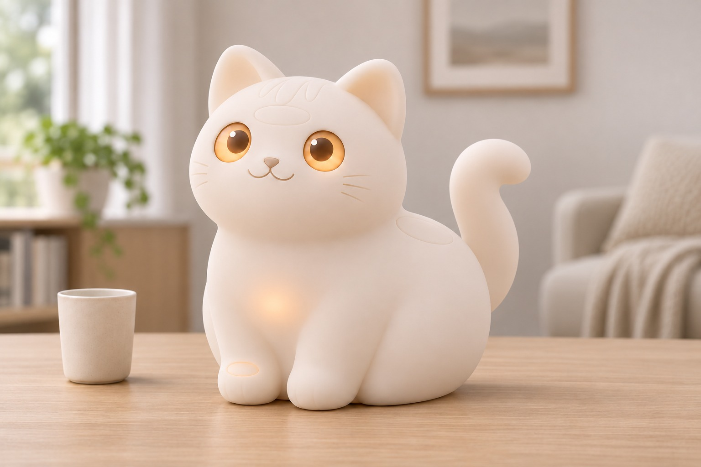
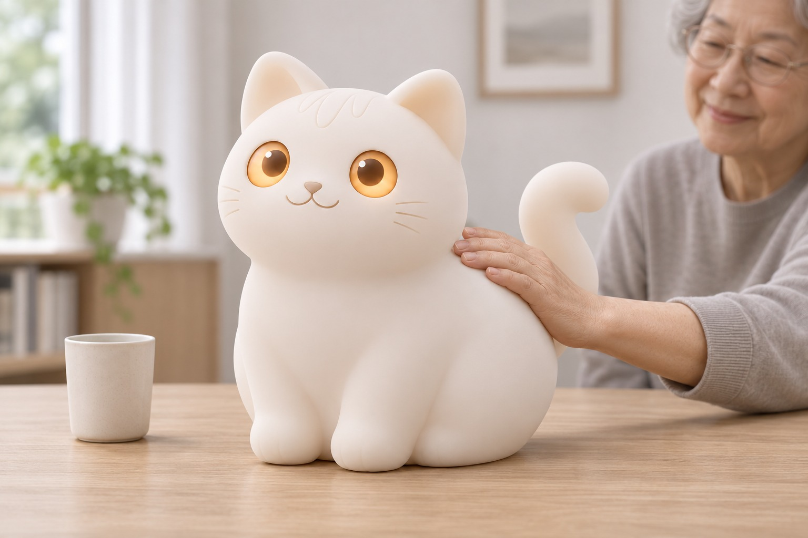
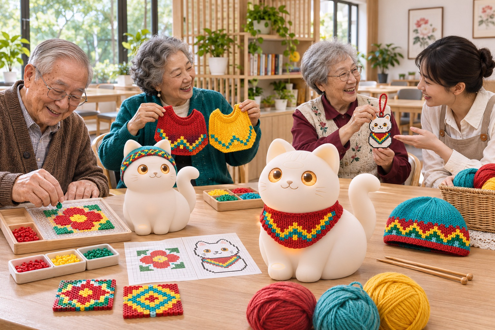

# 前期探索与设计进展

## 已有基础

前期围绕养老机构使用场景整理了 **26 页产品方案**、猫形外观与触摸情景的视觉探索，以及语音、触觉和日常提醒的功能设想。本次将这些积累重新组织为“小满”的独立参赛项目，进一步明确产品性格、实体交互和可实现的原型范围。

| 阶段 | 已形成的材料 | 在小满中的发展 |
| --- | --- | --- |
| 前期场景探索 | 养老陪伴产品方案，涵盖使用者、互动方式和形态方向 | 聚焦日常相处与主动亲近的体验 |
| 外观探索 | 圆头、短腿、卷尾的猫形构想 | 统一坐姿与连续柔软硅胶表皮，整理清楚的操作区域 |
| 交互构想 | 语音交流、摸头呼噜和生活提醒 | 收敛为三天可联调的触摸、对话、提醒闭环 |
| 当前参赛准备 | 品牌文案、交互流程、技术来源和开发计划 | 以 RDK 制作实物并记录实际表现 |

现阶段成果类型为**产品方案、交互设计与概念可视化**；下一阶段交付为可运行的交互原型。

## 造型方向

*当前造型概念：完整小猫、局部微光与浅浮雕触点。约28–30厘米的概念尺度通过打样确定。*

保留圆头、小耳朵、短前爪、圆润后腿与上卷尾巴。采用温暖的米白色，眼睛有清楚的深色瞳孔与琥珀色细节，表情安静亲近。外观采用连续柔软的硅胶表皮，尾巴与身体保持同样的材质，颈部和肢体之间以柔和过渡表达弹性。硅胶外层与内部支架分别设计。

## 柔软触感

*抚摸概念：手掌自然贴合背侧，柔软弹性、变形与回弹通过材料小样测定。*

触觉目标是温和、柔软、有支撑的接触体验。先比较硅胶厚度、硬度、表面处理和内部柔性支撑，记录轻压变形、回弹、触摸传感与清洁表现，再确定外层工艺。

坐姿作为本轮主造型参考，最终姿态结合稳定性、传感器和装配结果确定。桌面尺度让使用者坐着时容易看见、抚摸和说话。

## 养老机构中的日常情景

*未来共创场景：讨论围桌手作、选色与分享的关系；机构合作与实际体验结果在开展后记录。*

希望小满自然出现在茶几、床头和公共活动桌上。一次摸头、几句闲话和一个生活提醒，都可以成为日常相处的入口。多人空间中的播放音量、设备归属与轮流说话，在场景验证中进一步研究。

## 从方案到原型

本次实现优先级：头部触摸与呼噜 → 猫爪按键与简短语音 → 提醒确认与记录。上海话作为场景试点，动作机构先选一个头部或尾部微动作。

本轮补充局部暖光与额头、上背、猫爪触点；先完成猫爪输入与一处微光联调。乳白猫形保持统一，鲜亮配色通过围兜、露耳帽和披肩表达，原创方格纹样进一步延伸为拼豆包挂、杯垫和小相框。详见[微光与长者手作](COCREATION.md)。

实装记录将补充板卡与音频设备、接线与机构、运行方法、实物视频和测试结果。公开资料保留产品与交互内容，工程参数由打样与测量逐步补齐。

## 图片制作

本轮图片以已选猫形和养老机构情景为参考，通过图像接口重新渲染。材质修订集中于连续硅胶表皮、柔软轮廓与轻压反馈。图片用于设计交流和项目介绍。
